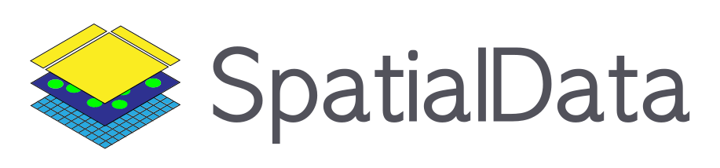

# spatialdata-io: convenient readers for loading common formats into SpatialData

[![Tests][badge-tests]][link-tests]
[![Documentation][badge-docs]][link-docs]
[](https://zenodo.org/badge/latestdoi/544045123)
[![PyPI][badge-pypi]][link-pypi]
[](https://anaconda.org/conda-forge/spatialdata-io)

[badge-tests]: https://github.com/scverse/spatialdata-io/actions/workflows/test.yaml/badge.svg
[link-tests]: https://github.com/scverse/spatialdata-io/actions/workflows/test.yaml
[badge-docs]: https://img.shields.io/readthedocs/spatialdata-io
[badge-pypi]: https://badge.fury.io/py/spatialdata-io.svg
[link-pypi]: https://pypi.org/project/spatialdata-io/

*We welcome contributions from the community and developers of spatial technologies.
See [How to contribute](#how-to-contribute).*

spatialdata-io provides readers for common spatial omics formats. It brings
images, labels, transcripts, shapes and expression tables together in a
[SpatialData](https://spatialdata.scverse.org/) object that you can save to Zarr.

## Supported formats

- [10x Genomics Visium®](docs/readers/visium.md)
- [10x Genomics Visium HD®](docs/readers/visium_hd.md)
- [10x Genomics Xenium®](docs/readers/xenium.md)
- [Akoya CODEX® Processor](docs/readers/codex.md)
- [Akoya PhenoCycler®-Fusion and quantitative pathology TIFF images](docs/readers/phenocycler.md)
- [Curio Seeker®](docs/readers/curio.md)
- [DBiT-seq](docs/readers/dbit.md)
- [MCMICRO output](docs/readers/mcmicro.md)
- [NanoString CosMx®](docs/readers/cosmx.md)
- [Spatial Genomics GenePS® (seqFISH)](docs/readers/seqfish.md)
- [Steinbock output](docs/readers/steinbock.md)
- [STOmics Stereo-seq®](docs/readers/stereoseq.md)
- [Vizgen MERSCOPE® (MERFISH)](docs/readers/merscope.md)
- [MACSima® (MACS® iQ View output)](docs/readers/macsima.md)

The guides list the supported layouts and versions, expected inputs, output
elements and coordinate units. See the [reader guide index](docs/readers/index.md).

The [generic reader](docs/readers/generic.md) handles individual TIFF, BTF, PNG,
JPEG and polygonal GeoJSON files. The [in situ sequencing (ISS) reader](docs/readers/iss.md)
is available from `spatialdata_io.experimental`.

Trademarks belong to their respective owners.

## How to contribute

1. Open a GitHub issue or comment on an existing one to describe the format and
   proposed change. See the [issue tracker][issue-tracker].
2. Submit a pull request with an example dataset or instructions for obtaining
   one so the reader can be tested and reviewed. See the [reader submission guide](docs/contributing_io.md).

To find a reader in development or pick up an earlier draft, browse the
[open pull requests][open-prs] and [closed, unmerged pull requests][unmerged-prs].

## Known limitations

- The Stereo-seq reader supports transcriptomic outputs from documented SAW
  7.0, 7.1, 8.0, 8.1 and 8.2 layouts, as well as compact numbered workflows and
  explicit flat exports. Protein, H5MU/OMNI and microorganism outputs fall
  outside its supported formats. See the [Stereo-seq guide](docs/readers/stereoseq.md).

## Getting started

Follow [Convert your first dataset](docs/user/first-conversion.md) to download
a small public Xenium experiment and verify its counts after writing. The
[offline image tutorial](docs/user/first-image.md) creates its own TIFF.

See the [Python API][link-api] and [command-line reference][link-cli] for reader
options and the [changelog](CHANGELOG.md) when upgrading.

## Installation

Install the latest release from PyPI using Python 3.12 or newer.

```bash
python -m pip install spatialdata-io
```

To install the development version from upstream `main`, run the following command.

```bash
python -m pip install git+https://github.com/scverse/spatialdata-io.git@main
```

## Contact

Ask usage questions on [scverse Discourse][scverse-discourse] and report bugs
in the [issue tracker][issue-tracker]. For a data-format issue, include the
producer version, directory layout and the output you expected.

## Readers from third-party libraries

- MALDI and other mass spectrometry imaging data via [METASPACE converter](https://github.com/metaspace2020/metaspace-converter)
- Mass spectrometry imaging with ion mobility and MS/MS (Bruker, Waters, PHI and imzML) via [Thyra](https://github.com/M4i-Imaging-Mass-Spectrometry/thyra)
- PhenoCycler®, MACSima® and Hyperion® (Imaging Mass Cytometry) via [Sopa](https://github.com/gustaveroussy/sopa)

## Disclaimer

The community maintains this library independently of the technology vendors,
without their official endorsement. The readers are provided without warranty
that they represent the source data correctly. Vendor formats can change between
releases, so check the reader guide for the versions and layouts it supports.
Report incorrect results or other bugs in the [issue tracker][issue-tracker].

## Solutions to common problems

### Slow visualization after reading vendor data

Write the converted dataset to Zarr and reopen it for visualization. For example,
with a supported Xenium output directory, you can write and reopen the same store
as follows.

```python
from spatialdata import read_zarr

from spatialdata_io import xenium

sdata = xenium("raw_data")
sdata.write("sample.zarr")
sdata = read_zarr("sample.zarr")
```

## Citation

Marconato, L., Palla, G., Yamauchi, K.A. et al. SpatialData: an open and universal data framework for spatial omics. Nat Methods (2024). https://doi.org/10.1038/s41592-024-02212-x

[scverse-discourse]: https://discourse.scverse.org/
[issue-tracker]: https://github.com/scverse/spatialdata-io/issues
[open-prs]: https://github.com/scverse/spatialdata-io/pulls?q=sort%3Aupdated-desc+is%3Apr+is%3Aopen
[unmerged-prs]: https://github.com/scverse/spatialdata-io/pulls?q=sort%3Aupdated-desc+is%3Apr+is%3Aunmerged+is%3Aclosed
[link-docs]: https://spatialdata.scverse.org/projects/io/en/stable/
[link-api]: https://spatialdata.scverse.org/projects/io/en/stable/api.html
[link-cli]: https://spatialdata.scverse.org/projects/io/en/stable/cli.html
[//]: # "numfocus-fiscal-sponsor-attribution"

spatialdata-io is part of the scverse® project ([website](https://scverse.org), [governance](https://scverse.org/about/roles)) and is fiscally sponsored by [NumFOCUS](https://numfocus.org/).
If you like scverse® and want to support our mission, please consider making a tax-deductible [donation](https://numfocus.org/donate-to-scverse) to help the project pay for developer time, professional services, travel, workshops, and a variety of other needs.

<div align="center">
<a href="https://numfocus.org/project/scverse">
  
</a>
</div>
